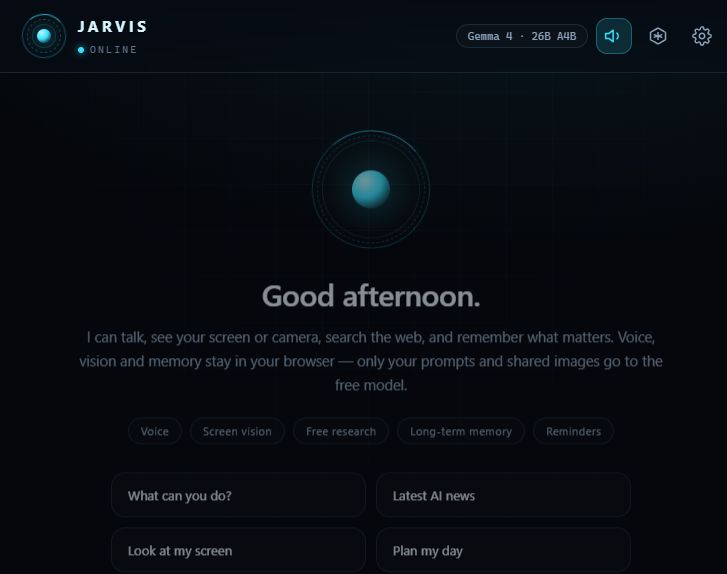

# J.A.R.V.I.S — Personal AI Agent (PWA)

Your own personal AI companion: **talk to it, make it remember you, and let it research the web — with no setup and no API key.**

J.A.R.V.I.S runs as an installable PWA. Visitors never paste a key: a small Supabase Edge Function (`jarvis-chat`) holds one OpenRouter key server-side and forwards **only free models**. If a model hits its rate limit, the app queues the next one and **continues the same answer mid-sentence** — the conversation never restarts.

## Live demo

> **https://stephen-techdev.github.io/jarvis-personal-agent/**

1. Open the link on laptop or phone.
2. Start chatting, talking or sharing your screen — no key, no sign-up.
3. Install it from the browser menu if you like (Android/desktop: "Install app", iPhone: Share → Add to Home Screen).



## What it does

| Capability | Implementation |
|---|---|
| **Keyless chat** | Supabase relay → OpenRouter's free `:free` models; Pollinations as last resort |
| **Automatic model queue** | Live free-model discovery at runtime; rate-limited models are skipped and queued alternatives tried |
| **Seamless continuation** | If a model dies mid-answer, the partial reply is passed to the next model, which continues exactly where it stopped |
| **Voice conversation** | Browser speech recognition → free model → streamed text-to-speech (barge-in supported) |
| **Vision** | Screen share (`getDisplayMedia`), camera (`getUserMedia`), or image upload → free vision model, no key |
| **Free web research** | DuckDuckGo results + page excerpts via the Jina reader proxy, answers with cited sources |
| **Long-term memory** | Local facts, notes, reminders and conversation summaries; automatic fact extraction on a rolling interval |
| **Reminders** | "Remind me in 10 minutes to stretch" → timer + notification + spoken reminder |
| **Notes** | "Note: buy coffee beans" → stored and shown in the Memory panel |
| **Multi-device** | Installable PWA — the same UI on every device |
| **Cooldown awareness** | A model that just failed is de-prioritised for 90 seconds, so retries do not hammer a dead endpoint |

## Why it is free

- **Chat:** the relay's key is used only for OpenRouter `:free` models; the function rejects anything that could cost money. Pollinations' anonymous model is a fallback.
- **Model discovery:** OpenRouter's public model list is fetched in the browser; no server needed.
- **Voice:** the browser's built-in speech recognition and speech synthesis.
- **Research:** DuckDuckGo + the free Jina reader proxy.
- **Hosting:** GitHub Pages (static) + Supabase Edge Functions free tier.
- **Storage:** browser `localStorage` — no database.

## Quick start (local development)

```bash
cd app
npm install
VITE_PROXY_URL="https://aymeydfagpzwnzqcnzic.supabase.co/functions/v1/jarvis-chat" npm run dev
```

Open the printed URL and start chatting — no key needed. The relay allows `localhost:5173` and `localhost:4173`.

Build for production:

```bash
VITE_PROXY_URL="https://aymeydfagpzwnzqcnzic.supabase.co/functions/v1/jarvis-chat" npm run build   # outputs app/dist
```

### Self-hosting without the relay

Build with `VITE_PROXY_URL=""` (or omit it). Each visitor then adds their own free [OpenRouter key](https://openrouter.ai/keys) in Settings. Nothing else changes.

### Deploying your own relay

The function lives in [`supabase/functions/jarvis-chat/index.ts`](supabase/functions/jarvis-chat/index.ts). Create a Supabase project, then:

```bash
supabase secrets set OPENROUTER_API_KEY=sk-or-v1-...
supabase functions deploy jarvis-chat --no-verify-jwt
```

Update `ALLOWED_ORIGINS` in the function to your own domain, then build the PWA with your function URL.

## How the free-model queue works

1. On load, the app fetches OpenRouter's live `:free` catalog and caches it for an hour.
2. Each message builds an ordered queue: your chosen model first, the remaining free models shuffled, Pollinations as the last resort.
3. The queue is attempted in order. A 429/5xx before any text silently moves to the next model.
4. A failure **after** text has streamed keeps the partial answer and asks the next model to continue it — no repetition, no restart.
5. Failed models are skipped for 90 seconds to avoid hammering them, and the header badge shows which model is currently answering.

## Architecture

```
┌──────────────────────────── Browser (PWA) ────────────────────────────┐
│  React + TypeScript UI                                                │
│  ├─ chat + markdown + sources                                         │
│  ├─ model catalog: OpenRouter /models (free only)                     │
│  ├─ queue engine: cooldowns + mid-stream continuation                 │
│  ├─ voice: SpeechRecognition → SpeechSynthesis                        │
│  ├─ vision: getUserMedia / getDisplayMedia → JPEG (≤1280px)           │
│  ├─ memory: localStorage (facts, notes, reminders, summary)           │
│  └─ research: r.jina.ai → DuckDuckGo → page excerpts                  │
└──────────────────────────────┬────────────────────────────────────────┘
                               │ HTTPS (no key in the browser)
                 ┌─────────────┴──────────────┐
                 │ Supabase Edge Function      │
                 │ jarvis-chat                 │
                 │ ├─ origin allow-list        │
                 │ ├─ rate limits              │
                 │ └─ free models only         │
                 └─────────────┬──────────────┘
                  ┌────────────┴────────────┐
                  │ OpenRouter `:free` pool │
                  │ Pollinations (keyless)  │
                  └─────────────────────────┘
```

The **local backend phase** (see roadmap) adds FastAPI + Whisper + Kokoro + OpenCode for computer control, offline use and private Tailscale access.

## Privacy & security

- The OpenRouter key lives only in Supabase secrets. It is never sent to, stored in, or requested by the browser.
- The relay accepts requests only from allow-listed origins, forwards only `:free` models, caps messages/tokens, and rate-limits each IP (60/min, 400/day).
- Chat messages pass through the relay to the model provider but are **not stored** by the function or Supabase.
- Conversations, facts, notes and reminders stay in your browser's `localStorage`.
- Images are downscaled and sent only when you explicitly attach/share them.
- The site has no analytics, no tracking, no database.
- Use **Export memory** to back up your data; **Clear memory** wipes everything.
- Never commit an API key. This repo contains none.

## Honest limitations of this build

- It is a **client**, not a computer-controlling agent. It cannot run files, shell commands or OpenCode yet — that is the local backend phase.
- Free models are heavily rate-limited and sometimes unavailable. The queue and continuation logic mitigate this but cannot eliminate it.
- The relay is shared; very heavy use can hit its per-IP limits.
- Browser speech recognition works best in Chrome/Edge; Firefox support varies.
- Screen sharing is unavailable on mobile browsers; the camera works everywhere HTTPS is available.
- Memory is per-browser; it is not synced across devices unless you export/import.

## Roadmap

- **Phase 0–1:** ✅ Keyless PWA brain, relay, free-model queue, memory, research, voice, vision
- **Phase 2:** Local FastAPI backend — Whisper STT + Kokoro TTS, fully offline voice
- **Phase 3:** Ollama fallback for offline chat and privacy mode
- **Phase 4:** OpenCode SDK executor — real coding tasks with permission gates
- **Phase 5:** Companion layer — proactive briefings, deeper memory consolidation
- **Phase 6:** Tailscale + laptop hosting — private access from every device
- **Phase 7:** Wake word, browser automation, computer interaction

See [FEATURES.md](FEATURES.md) for the open-source personal-agent analysis that shaped this build.

## Tech stack

React 19 · TypeScript · Vite 7 · Supabase Edge Functions · OpenRouter free tier · Pollinations · Web Speech API · MediaDevices · DuckDuckGo + Jina Reader · GitHub Pages.

## License

MIT — see [LICENSE](LICENSE).
